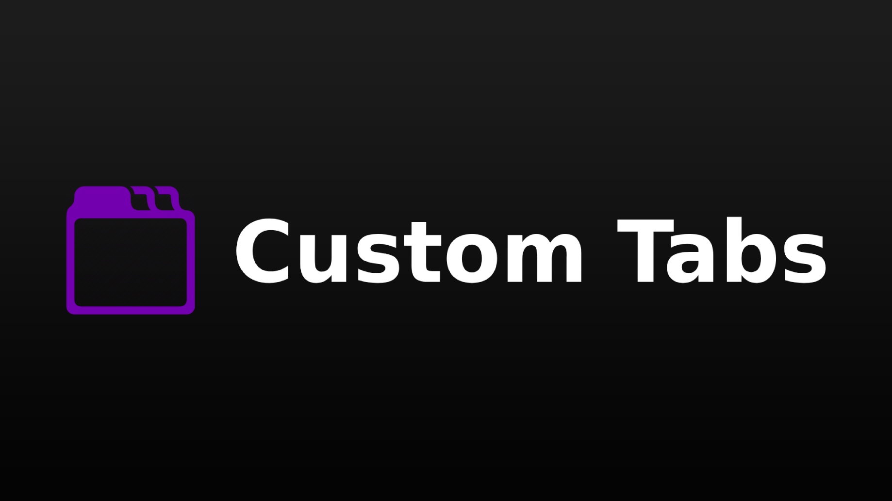

<h1 align="center">Custom Tabs</h1>
<h2 align="center">A Jellyfin Plugin</h2>
<p align="center">
    
    <br />
	<br />
	<a href="https://github.com/IAmParadox27/jellyfin-plugin-custom-tabs">
		
	</a>
	<a href="https://github.com/IAmParadox27/jellyfin-plugin-custom-tabs/releases">
		
	</a>
</p>

## Development Update - 20th August 2025

Hey all! Things are changing with my plugins are more and more people start to use them and report issues. In order to make it easier for me to manage I'm splitting bugs and features into different areas. For feature requests please head over to <a href="https://features.iamparadox.dev/">https://features.iamparadox.dev/</a> where you'll be able to signin with GitHub and make a feature request. For bugs please report them on the relevant GitHub repo and they will be added to the <a href="https://github.com/users/IAmParadox27/projects/1/views/1">project board</a> when I've seen them. I've found myself struggling to know when issues are made and such recently so I'm also planning to create a system that will monitor a particular view for new issues that come up and send me a notification which should hopefully allow me to keep more up to date and act faster on various issues.

As with a lot of devs, I am very momentum based in my personal life coding and there are often times when these projects may appear dormant, I assure you now that I don't plan to let these projects go stale for a long time, there just might be times where there isn't an update or response for a couple weeks, but I'll try to keep that better than it has been. With all new releases to Jellyfin I will be updating as soon as possible, I have already made a start on 10.11.0 and will release an update to my plugins hopefully not long after that version is officially released!

## Introduction
Custom Tabs is a Jellyfin plugin which allows users to add custom tabs to the horizontal bar at the top of the web client. A common use for this it to add a "Requests" tab.

The plugin has been inspired by, and makes use of the work done by, <a href="https://github.com/BobHasNoSoul/jellyfin-mods?tab=readme-ov-file#add-requests-tab">BobHasNoSoul</a>.

## Installation

### Prerequisites
- This plugin is based on Jellyfin Version `10.10.7`
- The following plugins are required to also be installed, please following their installation guides:
    - File Transformation (https://github.com/IAmParadox27/jellyfin-plugin-file-transformation) at least v2.2.1.0

### Installation
1. Add `https://www.iamparadox.dev/jellyfin/plugins/manifest.json` to your plugin repositories.
2. Install `Custom Tabs` from the Catalogue.
3. Restart Jellyfin.
4. In the admin dashboard, head to the "My Plugins" page and select "Custom Tabs"
5. You'll be presented with a settings screen where you can add custom tabs, name them how you wish and add content for each tab you wish to add.
6. Save the settings.
7. Force refresh your webpage (or app) and you should see your new sections instead of the original ones.

### FAQ

#### I've updated Jellyfin to latest version but I can't see the plugin available in the catalogue

The likelihood is the plugin hasn't been updated for that version of Jellyfin and the plugins are strictly 1 version compatible. Please wait until an update has been pushed. If you can see the version number in the release assets then please make an issue, but if its not in the assets, please wait. I know Jellyfin has updated, I'll update when I can.

## Example

<strong>Title: </strong>Requests

<strong>HTML Content:</strong>
```html
<style>
    :root {
        --save-gut: max(env(safe-area-inset-left), 3.3%);
    }
   @media only screen and (max-width: 990px) {
       .requestIframe{
           height: calc(100vh - 105.15px)!important;
           margin-top: -6.15px!important;
       }
   } 
    .requestIframe {
        width: 100%;
        height: calc(100vh - 50.716px);
        position: absolute;
        border: 0;
        margin-top: -20.716px;
    }
</style>
<div class="sections">
  <iframe class="requestIframe" src="{REQUESTS_URL}"></iframe>
</div>
```
<i><strong>Note:</strong> With the above `<style>` tags this will be applied to Jellyfin as a whole, to only affect the tab you're working on, you can surround with `#customTab_{index} { ... }` where `{index}` starts at 0 and counts up for every custom tab added.</i>

## Icons and Images

Each tab can show an icon or an image alongside, or instead of, its text:

- **Icon**: a [Material icon](https://fonts.google.com/icons?icon.set=Material+Icons) name, such as `movie`, `live_tv` or `request_page`. Jellyfin already ships this icon font.
- **Image URL**: any image URL, such as a service's logo. If both are set, the image is used.
- **Upload image**: pick an image file from your computer instead of typing a URL. PNG, JPEG, GIF, WebP and ICO files up to 2 MB are supported. The file is stored on the Jellyfin server in the plugin configurations folder, so it survives plugin updates, and it is deleted once no tab uses it and the settings are saved. Uploaded images are served without login so that browsers can display them, under a random, unguessable file name.
- **Hide text**: shows only the icon or image. The title is still used as the tooltip and the screen reader label. This option is ignored when no icon or image is set, so a tab is never blank. The mobile side menu always keeps the text.

## Issues
If you find an issue with any of the sections or usage of the plugin, please open an issue on GitHub. Please make sure to check the closed issues in case your issue has already been resolved, and also make sure to check the other plugins available from me as another plugin may have experienced the same issue.
